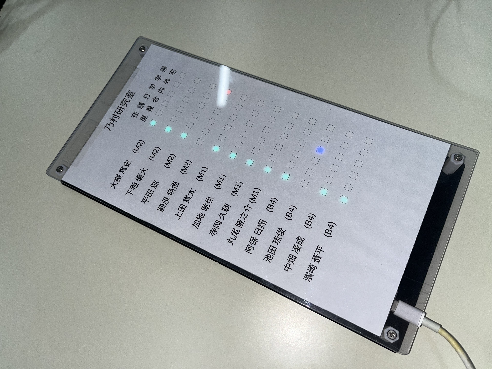
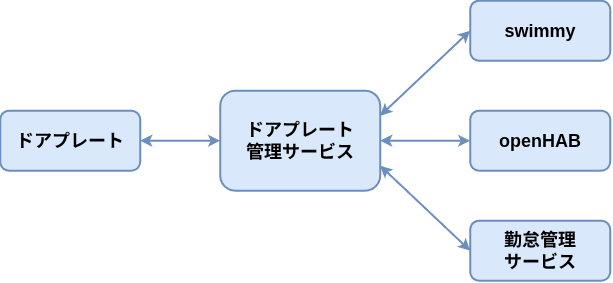

+++
date = '2026-10-08T11:00:00+09:00'
draft = false
title = 'ドアプレートで勤怠管理を自動化！'
showAuthor = true
authors = ['ueda']
+++

こんにちは，M1 の上田です．
昨年から勤怠管理とドアプレート管理の仕組みの見直しをしていたのですが，それがようやく完成したのでご紹介します！

## 勤怠管理について

勤怠管理というとお堅く聞こえますが，研究室にいつ来て，いつ帰ったかを記録するというものです．タイムカードのようなものですね．

これまでは，Slack ボットの [swimmy](https://github.com/nomlab/swimmy) を用いて勤怠管理を行っていました．
Slack 上で `swimmy hi`，`swimmy bye` とメッセージを投稿することで，入退室の時刻を記録できます．

ただ，毎回 Slack アプリを開いて投稿する手間があります．
また，投稿を忘れて入退室が記録されていない，ということが日常的に起こっています．

そこで，入退室の記録をある程度自動化できないかと考え，研究室に設置されているドアプレートを利用することにしました．
これが，今回の取り組みのきっかけだったりします．

## ドアプレートを使った勤怠管理

こちらが，乃村研究室で利用しているドアプレートです．

過去の記事でも何度か紹介されています．



こちらも入退室時に操作するものなので，ドアプレートを変更したら勤怠も自動で記録されるようになれば，もっと便利になります．
ドアプレートは研究室のサーバと MQTT で通信できるため，ドアプレートの変更を受け取って，勤怠管理を行うサービスを作れば良さそうです．

また，swimmy や openHAB など他のサービスから変更した場合も同様に記録したいですし，ついでにドアプレートの位置が連動して変わると便利ですね．

そこで，ドアプレートとその他のサービスの連携を担うサービスを間に挟んで，やりとりするようにしました．

これにより，ドアプレートから入退室を記録できるようになったり，swimmy や openHAB からドアプレートを変更できるようになったりしました！

## もくもく会も行っていました

ドアプレートによる勤怠管理を実現するにあたり，いくつかのサービスを修正する必要がありました．
中には大掛かりな修正や，仕組みを検討しないといけないものもありました．

そこで，7/17 に，これらのサービスを一気に直して連携できるようにしようということで，もくもく会を行いました．
研究室のメンバの中には，普段はこれらのサービスに関わっていない人や，内容をあまり知らない人もいました．
そのため，これを機に知ってもらおうという狙いもありました．

こちらは，作業中のメンバの様子です．

{{< carousel images="{PXL_20260717_065651965.jpg,IMG_8638.JPG,IMG_8641.JPG,IMG_8643.JPG,PXL_20260717_074122585.jpg,IMG_8642.JPG}" >}}

今回は，2〜3人でチームを組み，1つの問題を解決していく形で進めました．
問題を調査したり，コードを書き換えて実験したり，なかには熱い議論になっているチームもありました．

私がマネージャとして，もくもく会の進行，タスクの振り分けを行ったのですが，メンバの皆さんが説明をすぐ理解してくれたおかげで，問題がスムーズに解決していきました．
優秀なメンバに囲まれてありがたいです．

もくもく会の後には打ち上げも行いました．
数ヶ月前のことなので，何を話したかは忘れてしまいましたが，楽しかったということは覚えています...！

{{< carousel images={"IMG_8651.JPG,IMG_8654.JPG,PXL_20260717_105948660.jpg,PXL_20260717_112051795.jpg"} >}}

## おわりに

勤怠管理とドアプレートの整備が，ようやく落ち着きました．
この取り組みは，私が関わる前から長く続いており，引き継いでからも半年かかりました．
その分思い入れも強く，実際に使われて，正常に動作しているというのが，とても嬉しいです！
