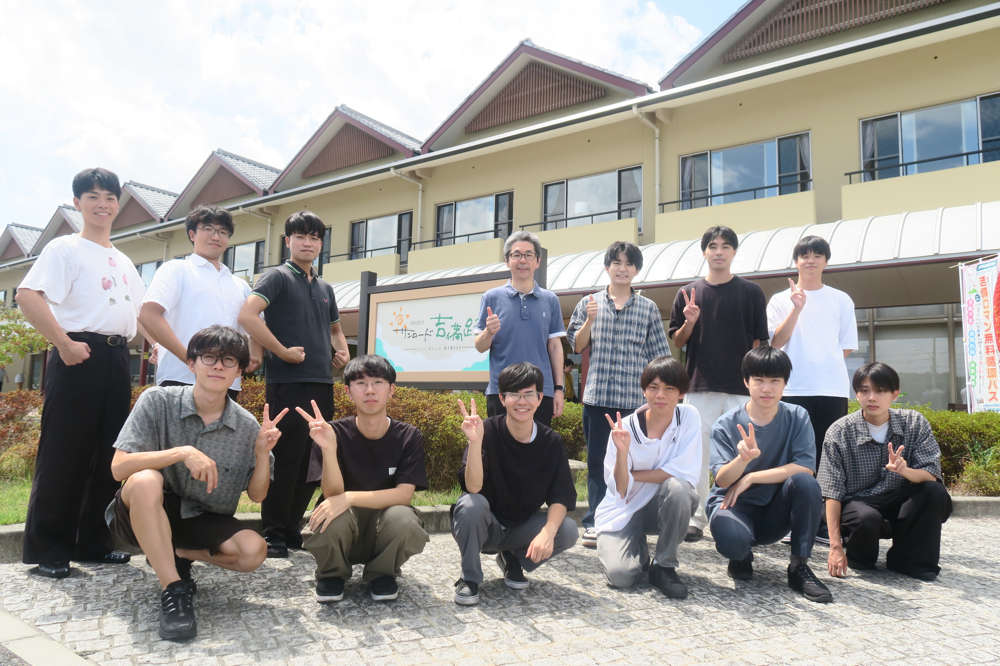
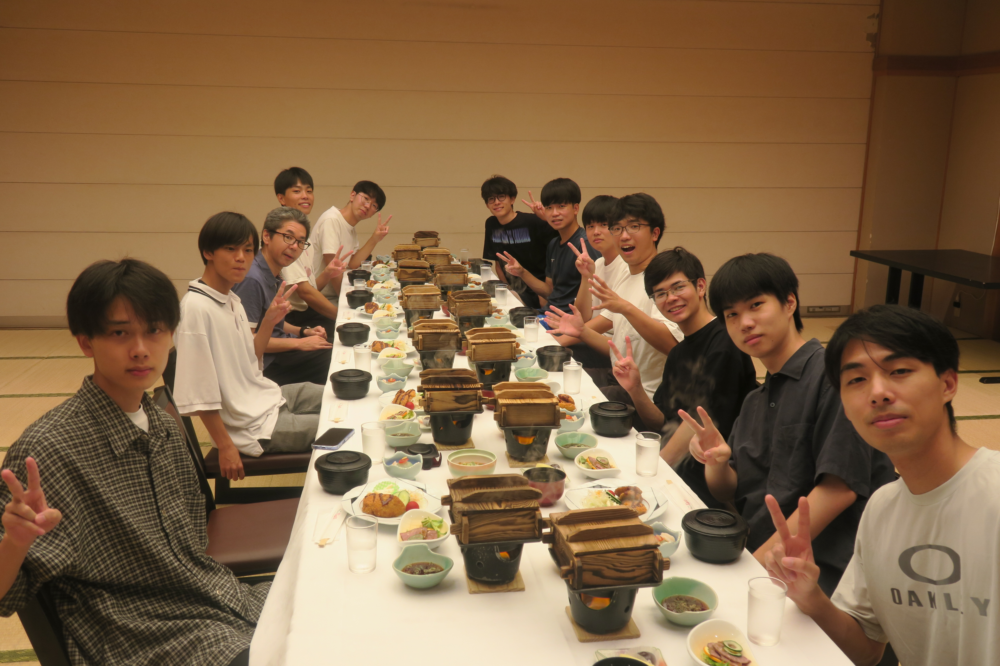

+++
date = '2026-10-22T15:33:56+09:00'
draft = false
title = '2026年度乃村研研修会'
showAuthor = true
authors = ['maruo']
+++

こんにちは！M1 の丸尾です．

遅くなりましたが 8/30(日)，8/31(月) に乃村研究室研修会が行われました．
今年もここ数年に引き続き，[国民宿舎サンロード吉備路](https://sunroad-kibiji.com/)での開催です．
サンロード吉備路は，今年6月に約半年間の改装工事を経てリニューアルオープンしており，今年は新しくなった施設での研修会となりました．

サンロード吉備路に到着すると，お弁当を食べてそのまま LT 大会を行いました．

{{< carousel images="{images/IMG_4429.JPG,images/IMG_8760.JPG}" >}}

今年は LT 大会後の周辺散策をカットしたことにより1人あたりの時間を多めに取ることができました．
個人的には，加地くんの「宇宙人に伝えたい」という発表が特に印象に残っています．
宇宙人との遭遇を「あ，宇宙人だ」の一言で済ませてしまうシュールな導入が面白かったです．
普通なら大騒ぎになりそうな場面をあっさり流し，何事もなかったかのように宇宙人との意思疎通の話へ進んでいく展開が絶妙で，開始早々に引き込まれました．

{{< carousel images="{images/IMG_8807.JPG,images/IMG_8776.JPG,images/IMG_8775.JPG,images/IMG_8778.JPG,images/IMG_8798.JPG}" >}}

LT 大会後は 1 階の卓球場で卓球を行いました．
想像以上の盛り上がりを見せ，みんなで卓球を楽しみました．
その盛り上がりは研修会中だけにとどまらず，研修会後も研究室内で卓球ブームが続くほどでした．

{{< carousel images="{images/IMG_4440.JPG,images/IMG_4448.JPG,images/IMG_4443.JPG}" >}}

入浴後には，豪華な夕食をいただきました！

その後，談話会が行われました．
各自1000円程度でお酒やおつまみを持ち寄って，楽しい宴会になりました．
僕は去年，途中でダウンしてしまったのですが，今年は程々にしたおかげで最後まで楽しむことができました！

{{< carousel images="{images/IMG_8849.JPG,images/IMG_8855.JPG,images/IMG_8858.JPG}" >}}

解散後は，もう一度温泉に入ったり卓球をしたりゲームしたりして就寝しました．

翌朝，目が覚めると，前日の卓球の影響で筋肉痛になっていました．
思っていた以上に卓球がいい運動になっていたようです．
朝食はバイキング形式で，朝から美味しい料理をお腹いっぱい食べることができました！

今年は改修後初のサンロード吉備路での研修会となりましたが，例年と変わらず充実した2日間を過ごすことができました．LT 大会や卓球，談話会などを通じて，先輩・後輩の仲もより一層深まったと思います．

来年の研修会も楽しみです！

